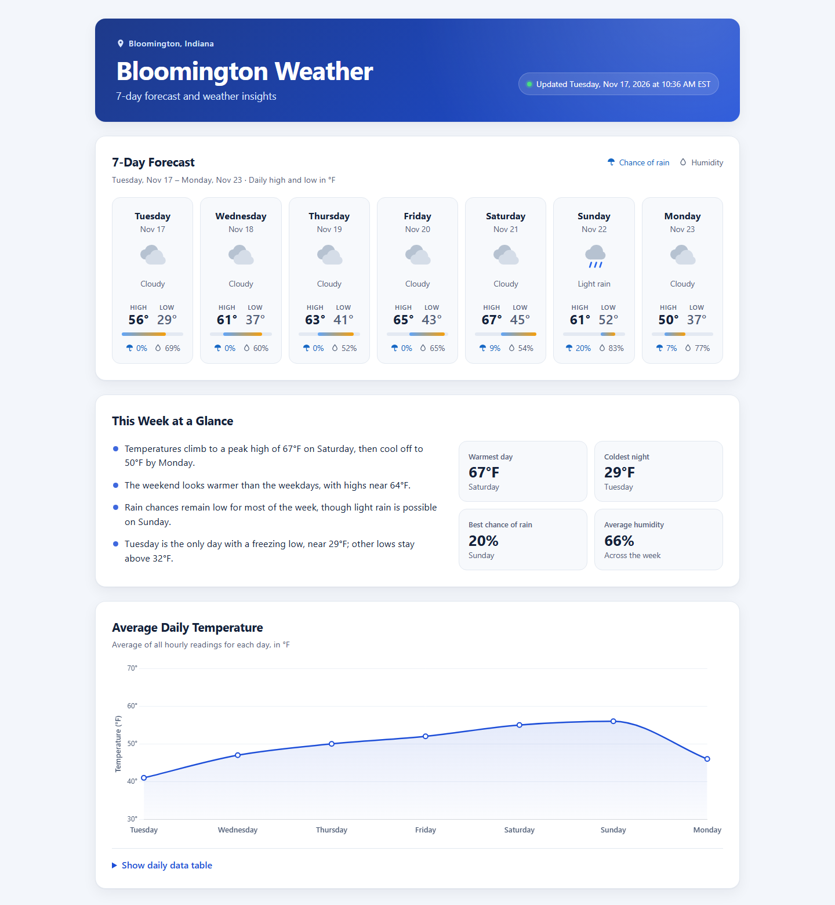
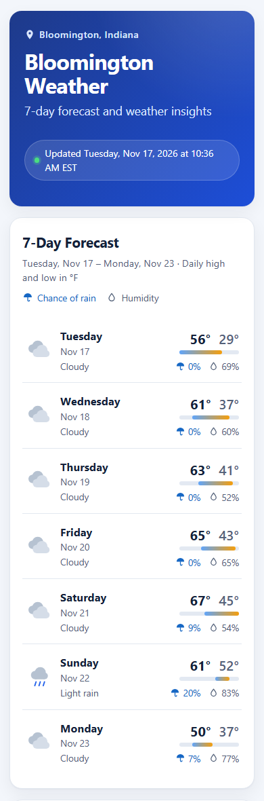
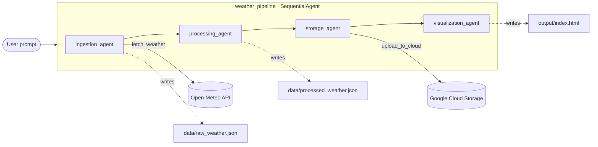

# Bloomington Weather Analytics Pipeline

A multi-agent data pipeline built with the **Google Agent Development Kit (ADK)** and **Gemini**. It fetches a 7-day hourly forecast for Bloomington, Indiana, turns it into daily summaries, archives the data in **Google Cloud Storage**, and publishes a responsive weather dashboard.

<p align="center">
  
  &nbsp;
  
</p>

---

## Overview

The project shows how to build a small but complete data-engineering workflow from cooperating AI agents. Each agent owns one pipeline stage and calls one deterministic Python tool. The LLM handles orchestration and reporting, while all data handling is done by plain, tested Python code.

One run of the pipeline:

1. **Ingests** 168 hourly records (7 days × 24 hours) from the Open-Meteo forecast API.
2. **Processes** them into 7 daily summaries (high, low, average, chance of rain, humidity, conditions) and converts temperatures to Fahrenheit.
3. **Stores** the raw and processed JSON in a Google Cloud Storage bucket and verifies each upload with a checksum.
4. **Visualizes** the results as a self-contained HTML dashboard.

## Key features

- **Four-agent sequential pipeline** built on Google ADK (`SequentialAgent` + `LlmAgent`s).
- **Single API request per run.** Hourly readings and daily weather codes come from one Open-Meteo call.
- **Raw data preserved.** `raw_weather.json` is stored exactly as the API returns it, in °C.
- **One-time unit conversion.** Temperatures are aggregated in °C and converted to °F in exactly one place.
- **Data validation.** Malformed responses are rejected, and missing or physically impossible readings are dropped and counted.
- **Plain-English weekly summary** generated only from the forecast data (trends, weekend outlook, rain chances, freezing nights).
- **Verified cloud uploads.** Each file's MD5 checksum is compared with the stored object after upload.
- **Graceful error handling.** Tools return structured `success` / `error` results, agents report failures honestly, and downstream steps never reuse stale data from earlier runs.
- **Resilient API calls.** Automatic retries with backoff for both Open-Meteo and Gemini (429/5xx).
- **Responsive, accessible dashboard.** Weekday-based forecast cards, weather icons, a temperature chart and a data table, from phone to desktop.
- **Offline test suite** (20 tests) that runs without network, cloud or LLM access.

## Architecture



| Agent | Tool | Responsibility | Passes on (`temp:` state) |
|---|---|---|---|
| `ingestion_agent` | `fetch_weather` | Calls Open-Meteo, validates the response, saves the raw JSON | `temp:raw_weather` |
| `processing_agent` | `process_weather` | Cleans hourly data, builds 7 daily summaries in °F, writes the weekly summary | `temp:processed_weather` |
| `storage_agent` | `upload_to_cloud` | Uploads both JSON files to GCS and verifies their checksums | `temp:storage_status` |
| `visualization_agent` | `create_dashboard` | Renders `output/index.html` from this run's processed data | — |

**How the agents work together**

- The root `SequentialAgent` runs the four agents in a fixed order, so each stage starts only after the previous one finishes.
- Data moves between stages through ADK **invocation-scoped `temp:` state**. It is shared by every agent in a single run and is never persisted to the session database.
- Every tool returns `{"status": "success", ...}` or `{"status": "error", "message": ...}`. If a stage fails, later stages detect the missing state and refuse to run, so stale files are never uploaded or displayed.
- All four agents share one model setting (`gemini-3.5-flash-lite` by default) and a retry policy for transient Gemini errors.

**Code layout**

- [`weather_agent/agent.py`](weather_agent/agent.py): configuration, the four ADK tools, the agents and the orchestrator.
- [`weather_agent/weather_utils.py`](weather_agent/weather_utils.py): pure functions for validation, °C→°F conversion, WMO weather codes, daily aggregation and summary text.
- [`weather_agent/dashboard.py`](weather_agent/dashboard.py): pure HTML/CSS/SVG rendering of the dashboard.

## Technologies

| Area | Technology |
|---|---|
| Agent framework | [Google ADK](https://google.github.io/adk-docs/) (`google-adk`) |
| LLM | Google Gemini via `google-genai` |
| Data processing | Python 3.11+, pandas |
| HTTP | requests + urllib3 retry |
| Cloud storage | Google Cloud Storage (`google-cloud-storage`) |
| Configuration | python-dotenv |
| Dashboard | HTML5, CSS (grid / media queries), inline SVG icons, [Chart.js](https://www.chartjs.org/) |
| Testing | Python `unittest` |

## Data source: Open-Meteo

Forecast data comes from the free [Open-Meteo Forecast API](https://open-meteo.com/en/docs), which needs no API key. Each run makes one request:

| Parameter | Value |
|---|---|
| Location | Bloomington, IN (39.1653, -86.5264) |
| Hourly variables | `temperature_2m` (°C), `precipitation_probability` (%), `relative_humidity_2m` (%) |
| Daily variables | `weather_code` (WMO code, used for condition labels and icons) |
| Range | `forecast_days=7` → 168 hourly records |
| Time zone | `America/Indiana/Indianapolis` |

**How values are summarized**

- **High / low / average:** max, min and mean of the day's hourly temperatures, converted with `F = C × 9/5 + 32`.
- **Chance of rain:** the highest hourly precipitation probability of the day. The daily average is also stored.
- **Humidity:** the mean hourly relative humidity.
- **Conditions:** Open-Meteo's daily WMO code, mapped to a plain label (e.g. *Partly cloudy*, *Light rain*).

## Google Cloud Storage integration

The storage agent uploads both data files to your bucket on every run, overwriting the previous versions:

```
gs://<your-bucket>/weather-data/raw_weather.json
gs://<your-bucket>/weather-data/processed_weather.json
```

Authentication uses a **service account key** referenced by `GOOGLE_APPLICATION_CREDENTIALS`. The service account needs permission to create, overwrite and read objects in the bucket. The **Storage Object User** role (`roles/storage.objectUser`) on that bucket covers this. After each upload the tool reloads the object's metadata and compares its MD5 hash with the local file.

## Getting started

### Prerequisites

- Python **3.11 or newer** (tested with 3.14)
- A **Gemini API key** from [Google AI Studio](https://aistudio.google.com/apikey)
- A **Google Cloud project** with:
  - a Cloud Storage bucket
  - a service account with `roles/storage.objectUser` on that bucket, and a downloaded JSON key

### 1. Install dependencies

```bash
git clone <your-repo-url>
cd weather-agent-pipeline

python -m venv .venv
# Windows (PowerShell)
.venv\Scripts\Activate.ps1
# macOS / Linux
source .venv/bin/activate

pip install -r requirements.txt
```

### 2. Configure environment variables

The project uses two `.env` files. Copy the templates and fill in your values:

```bash
cp .env.example .env                              # Google Cloud settings
cp weather_agent/.env.example weather_agent/.env  # Gemini settings
```

| File | Variable | Purpose |
|---|---|---|
| `.env` | `GCS_BUCKET_NAME` | Target Cloud Storage bucket |
| `.env` | `GOOGLE_CLOUD_PROJECT` | Project that owns the bucket |
| `.env` | `GOOGLE_APPLICATION_CREDENTIALS` | Path to the service account key (relative to the project root or absolute) |
| `weather_agent/.env` | `GOOGLE_API_KEY` | Gemini API key |
| `weather_agent/.env` | `GOOGLE_GENAI_USE_ENTERPRISE` | `0` to use the Gemini Developer API |
| `weather_agent/.env` | `GEMINI_MODEL` | *Optional.* Overrides the default model |

Place the service account key in the project root (or anywhere else) and point `GOOGLE_APPLICATION_CREDENTIALS` at it. Key files, `.env` files and all `*.json` files are excluded by `.gitignore`.

### 3. Run the pipeline

From the project root:

```bash
adk run weather_agent
```

At the `[user]:` prompt, type a request such as:

```
Run the weather pipeline.
```

Each agent reports its result in turn. Type `exit` to quit. You can also use the ADK browser UI with `adk web` and select `weather_agent`.

### 4. View the dashboard

Open `output/index.html` in a browser. It is regenerated on every run. The chart loads Chart.js from a CDN. If you're offline, the same numbers are still available in the dashboard's data table.

## Running the tests

The test suite runs fully offline. It uses synthetic forecast data and mocks the network, so no API keys or cloud access are needed.

```bash
python -m unittest discover -s tests -v
```

It covers:

- Fahrenheit conversion and rounding
- 7-day aggregation, weekday labels and weather-code mapping
- Raw data immutability and handling of missing or invalid readings
- Summary text that doesn't invent rain or trends
- Dashboard content (weekday labels, °F only, chart values match the cards and table)
- Tool error paths (network failure, missing bucket, missing upstream data)

## Project structure

```
weather-agent-pipeline/
├── weather_agent/              # ADK agent package (run with `adk run weather_agent`)
│   ├── __init__.py
│   ├── agent.py                # Tools, four agents, SequentialAgent orchestrator
│   ├── weather_utils.py        # Validation, conversion, aggregation, summaries
│   ├── dashboard.py            # HTML dashboard renderer
│   └── .env.example            # Gemini settings template
├── tests/
│   └── test_weather_pipeline.py
├── docs/                       # README screenshots
│   ├── dashboard-desktop.png
│   └── dashboard-mobile.png
├── data/                       # Generated: raw + processed JSON (git-ignored)
├── output/                     # Generated: index.html dashboard (git-ignored)
├── .env.example                # Google Cloud settings template
├── .gitignore
├── requirements.txt
├── README.md
└── FUTURE_IMPROVEMENTS.md
```

## Processed data format

`data/processed_weather.json` (abridged):

```json
{
  "location": "Bloomington, Indiana",
  "timezone": "America/Indiana/Indianapolis",
  "processed_at": "2026-11-17T10:36:00-05:00",
  "units": { "temperature": "°F", "precipitation_probability": "%", "humidity": "%" },
  "total_days": 7,
  "daily_forecast": [
    {
      "date": "2026-11-17",
      "weekday": "Tuesday",
      "average_temperature_f": 41.1,
      "maximum_temperature_f": 55.9,
      "minimum_temperature_f": 28.9,
      "average_precipitation_probability": 0.0,
      "maximum_precipitation_probability": 0,
      "average_humidity": 68.5,
      "weather_code": 3,
      "condition": "Cloudy",
      "hourly_readings": 24
    }
  ],
  "weekly_summary": ["Temperatures climb to a peak high of 67°F on Saturday, ..."]
}
```

## Future work

See [FUTURE_IMPROVEMENTS.md](FUTURE_IMPROVEMENTS.md) for the roadmap: scheduling, monitoring, security hardening, cost optimization and more.

## Acknowledgements

- Weather data by [Open-Meteo.com](https://open-meteo.com/) (CC BY 4.0).
- Built with [Google Agent Development Kit](https://google.github.io/adk-docs/).
